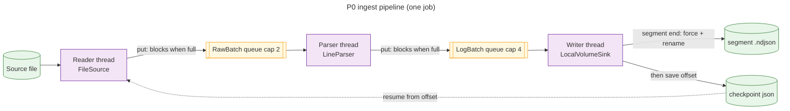

# P0 Plan: Streaming File Ingest Foundation

> Phase P0 of [`SCALING_DESIGN.md`](SCALING_DESIGN.md) §12. Status: **implemented** on `feature/p0-streaming-ingest`; results in §10.
> Exit criteria: **T2** (heap ≤2.4GB, no OOM on a 10GB file) and **T4** (kill -9 at any point → no lost records, duplicates only as idempotent overwrites).

## 1. Goal and scope

Process a log file of **any size** with bounded memory, write the parsed output to local disk, and resume after a crash from the last committed position.

| In scope (P0) | Out of scope (later phase) |
|---|---|
| `FileSource`: streamed reads with exact byte offsets | Directory tailing / rotation following (P3) |
| Batches (≤10,000 lines / ≤8MB) and segments (≤500MB) | Parser registry, `LogEnvelope`, suppression (P1) |
| Bounded queues + 3-stage pipeline with backpressure | Parquet, S3/GCS, WAL watermarks, retries (P2) |
| `FileCheckpointStore` (atomic, crash-safe) | HTTP push ingest, tenancy, quotas (P3) |
| `LocalVolumeSink` writing NDJSON segment files | Live tail, canonical log lines, metrics (P4) |
| Async job API: `/api/v2/ingest` | OpenSearch, Kafka (P5) |

The existing `/api/v1/logs/*` endpoints are **left unchanged** in P0 (they still return whole result lists and keep the 50MB guard). They'll move onto the pipeline once streaming aggregation exists (P1).

## 2. Key concepts

| Unit | Size | Role |
|---|---|---|
| **Batch** | ≤10,000 lines **or** ≤8MB raw, whichever comes first | The unit held in memory and passed between stages |
| **Segment** | ≈500MB of source bytes (closed at the next batch boundary, so ≤500MB + 8MB) | The unit of durability: one output file, one checkpoint |

Why the segment is the commit unit:
- **Few large output files:** about 20 files per 10GB, not thousands of 3MB files.
- **One checkpoint write per segment.**
- **Bounded replay on a crash:** at most one segment is reprocessed, and its output file is overwritten rather than duplicated.

## 3. Components

New packages under `dev.dinesh.argus`:

| Class | Package | Responsibility |
|---|---|---|
| `IngestProperties` | `config` | `@ConfigurationProperties("argus.ingest")`: batch lines/bytes, segment bytes, queue capacities, max line length, max concurrent jobs, allowed roots. The configuration processor is already in the pom. |
| `SourceOffset` | `source` | record `(sourceId, path, fileKey, byteOffset)`. `fileKey` comes from `BasicFileAttributes.fileKey()` (the inode on Linux/macOS) and is used to detect a replaced file. |
| `RawBatch` | `source` | record `(sourceId, segmentIndex, sequence, List<String> lines, long startOffset, long endOffset, boolean lastInSegment)` |
| `LogBatch` | `source` | the same fields with `List<LogRecord> records` and `int rejected` (lines that failed to parse) |
| `FileSource` | `source` | Reads with a `FileChannel` and a 64KB `ByteBuffer`, splits on `\n`, and tracks the **exact byte offset** (needed for resume; `BufferedReader` can't report one). Handles CRLF, a final line without a newline, UTF-8 characters split across buffer reads (by decoding whole lines, not buffers), and lines over `max-line-bytes` (truncated + counted). Emits a `RawBatch` and closes a segment once ≥500MB has been read. |
| `LineParser` | `parser` | `Function<String, LogRecord>` wrapping the parsing currently in `LogService.parseLineSafely`, moved out unchanged so `LogService` and the pipeline share it (no duplication). P1 replaces it with `ParserRegistry`. |
| `CheckpointStore` / `FileCheckpointStore` | `checkpoint` | `Optional<SourceOffset> load(sourceId)` / `save(SourceOffset)`. One JSON file per source in `argus.ingest.checkpoint-dir`. Writes go to `*.tmp`, then `FileChannel.force(true)`, then `Files.move(ATOMIC_MOVE)`. A corrupt file is logged and treated as missing. |
| `LogSink` | `sink` | Port with `SegmentWriter open(SegmentId)`, `writer.write(LogBatch)`, `writer.commit(endOffset) → Path`, `writer.abort()` |
| `LocalVolumeSink` | `sink` | Writes NDJSON (one `LogRecord` per line, using Spring's `ObjectMapper` so `Instant` serializes correctly) to `<root>/tenant=default/dt=YYYY-MM-DD/<sourceId>-<startOffset>.ndjson.part`. On commit it calls `force`, then renames to `<sourceId>-<start>-<end>.ndjson`. `abort` and startup cleanup delete stale `.part` files. Before opening a segment it checks free space is above `min-free-bytes`, or fails the job with a clear error. |
| `IngestPipeline` | `ingest` | Runs one job: reader thread → `ArrayBlockingQueue<RawBatch>(2)` → parser thread → `ArrayBlockingQueue<LogBatch>(4)` → writer thread. Applies the commit protocol in §4. |
| `IngestJob`, `IngestJobService` | `ingest` | Job state (`QUEUED`, `RUNNING`, `COMPLETED`, `FAILED`, `CANCELLED`) and live counters: bytes read, lines, rejected, segments committed, current offset. A bounded executor (`max-concurrent-jobs=2`, queue 0) rejects extra jobs. Jobs are kept in memory; after a restart, re-submitting the same `sourceId` resumes from its checkpoint. |
| `IngestController` | `controller` | `POST /api/v2/ingest/file`, `GET /api/v2/ingest/jobs/{id}`, `DELETE /api/v2/ingest/jobs/{id}` (§5) |

**Why one thread per stage.** At the target ~4k lines/s, a single parser thread is far from saturated: regex parsing runs at roughly 100k+ lines/s. One thread per stage also keeps batches **in order**, which the segment commit protocol relies on. Parallel parsing with re-ordering is deferred until a benchmark shows it's needed.

## 4. Data flow and commit protocol



1. **Start.** Load the checkpoint for `sourceId`, then decide where to begin:
   - Start at byte 0 if there's no checkpoint, the `fileKey` differs (file was replaced), or `size < offset` (file was truncated). Log a warning in the last two cases.
   - Otherwise start at the checkpoint offset.
   - `fromBeginning=true` forces byte 0.
2. **Read.** The reader emits batches and marks the last batch of each segment. `queue.put` blocks while the parser is behind. **This blocking is the backpressure.**
3. **Parse.** Unparseable lines are counted in `rejected`. A sample of the first 10 is logged, per job.
4. **Write.**
   - The first batch of a segment opens a `.part` file.
   - Each batch is appended to it.
   - On the last batch, the writer calls `commit(endOffset)` (`force` + rename), and **only then** calls `checkpoint.save(endOffset)`.
5. **Finish.** At end of file, the final partial segment is committed in the same way.
6. **Failure in any stage** (I/O error, disk full, cancel):
   - Set a shared cancel flag and interrupt the other stage threads.
   - The writer aborts the open `.part` file.
   - The job becomes `FAILED` or `CANCELLED`, and the checkpoint is left at the last committed segment.

**Crash anywhere.** On restart, delete stale `.part` files and resume from the checkpoint. What happens depends on where the crash landed:

| Crash point | Effect on restart |
|---|---|
| Before the rename | That segment is redone from its start. |
| Between the rename and the checkpoint save | The segment is redone and **overwrites the same file name**, because the name comes from its offsets. |

In both cases no records are lost and none are duplicated (meets T4).

### Memory budget (per job)
- **In flight:** at most 2 + 4 queued batches, plus 1 in each of the 3 stages = 9 batches.
- **Typical:** 3MB raw per batch ≈ 12MB as objects, so about 110MB.
- **Worst case:** 8MB batches, about 360MB.
- **Two concurrent jobs:** at most about 720MB, which fits the 2.4GB heap with room for the existing v1 endpoints.

## 5. API (new, v2)

| Method | Path | Body / response |
|---|---|---|
| `POST` | `/api/v2/ingest/file` | Body `{ "path": "...", "sourceId": "optional", "fromBeginning": false }`. Responses: **202** `{jobId, sourceId, startOffset}`; **400** if the path is outside `allowed-roots` or isn't a regular file; **404** if the file is missing; **429** + `Retry-After` if all job slots are busy. |
| `GET` | `/api/v2/ingest/jobs/{id}` | **200** `{state, bytesRead, totalBytes, percent, lines, rejected, segmentsCommitted, committedOffset, outputs[], error}`; **404** for an unknown job |
| `DELETE` | `/api/v2/ingest/jobs/{id}` | **202**: cancel the job; it stops at its next batch boundary |

- `sourceId` defaults to a short hash of the canonical absolute path, so re-submitting the same file resumes it.
- **Security:** P0 adds an `allowed-roots` check (`toRealPath()` must start with an allowed root). It closes the arbitrary-file-read problem for v2. The same issue exists in v1 (`?file=` accepts any path) and is tracked separately.

## 6. Configuration (`application.properties`)
```properties
argus.ingest.batch-max-lines=10000
argus.ingest.batch-max-bytes=8MB
argus.ingest.segment-bytes=500MB
argus.ingest.raw-queue-capacity=2
argus.ingest.parsed-queue-capacity=4
argus.ingest.max-line-bytes=1MB
argus.ingest.max-concurrent-jobs=2
argus.ingest.allowed-roots=./src/main/resources/logs,./data/in
argus.ingest.checkpoint-dir=./data/checkpoints
argus.sink.local.root=./data/out
argus.sink.local.min-free-bytes=2GB
```
- Sizes bind to `DataSize`.
- Add `data/` to `.gitignore`.
- JVM flags for the target box (documented in CLAUDE.md, not hardcoded): `-XX:MaxRAMPercentage=60 -XX:MaxDirectMemorySize=512m -XX:+ExitOnOutOfMemoryError`

## 7. Tests

| Test class | Proves |
|---|---|
| `FileSourceTest` | Batch closes at exactly 10,000 lines and at 8MB; byte offsets are exact (resuming at any batch's `endOffset` reproduces the remaining lines exactly); CRLF; final line without a newline; a multibyte UTF-8 character split across the 64KB buffer; an overlong line is truncated and counted; blank lines are skipped; segment closes at the 500MB boundary (with a small configured segment size) |
| `FileCheckpointStoreTest` | Save/load round trip; a leftover `.tmp` file is ignored; corrupt JSON → empty + warning; resume logic for a changed `fileKey` and for a truncated file |
| `LocalVolumeSinkTest` | Directory layout and offset-based file names; `.part` → final file on commit; `abort` deletes the `.part`; re-committing the same segment overwrites it; low free space fails fast |
| `IngestPipelineTest` | **Backpressure:** with a deliberately slow sink, queue sizes never exceed capacity and bytes read minus bytes written stays bounded. **Crash/resume:** the sink throws during segment 3; a rerun produces output byte-identical to a clean run, with no gaps or duplicates. **Cancel:** stops at a batch boundary; the checkpoint equals the last committed segment |
| `IngestControllerTest` (`@WebMvcTest`) | 202 / 400 / 404 / 429 responses and the job status JSON |
| `LargeFileIngestIT` (tagged `load`, excluded from `mvn test`) | Generates a 1GB file into a temporary directory and ingests it in a forked JVM with **`-Xmx256m`**: completes with no OOM and the line count matches. This proves memory use doesn't grow with file size. |

**Manual T2 run (results recorded in the PR):**
- Generate a 10GB file with a streaming generator. P0 also adds `DataSeeder.generateNginxLogs(path, targetBytes)`, which writes through a `BufferedWriter` and never builds the file in memory.
- Run the JAR with `-Xmx2400m` in a 4GB container (`docker run -m 4g`).
- Record lines/s, peak heap (via `jcmd GC.heap_info` or Actuator `/actuator/metrics/jvm.memory.used`), GC pause time, and total time.

**Manual T4 run:**
- `kill -9` the process during segments 2, 5 and 10, then re-submit the job.
- Check that the output line count equals the source line count minus rejected lines, and that the `.ndjson` file names have no overlapping offset ranges.

## 8. Implementation order (one PR, one commit per step)
1. `IngestProperties` + `SourceOffset` / `RawBatch` / `LogBatch` + `.gitignore`
2. `FileSource` + `FileSourceTest`
3. `CheckpointStore` + `FileCheckpointStore` + tests
4. `LogSink` + `LocalVolumeSink` + tests
5. Move `parseLineSafely` into `LineParser`; `LogService` uses it (v1 behaviour unchanged, existing tests pass)
6. `IngestPipeline` + `IngestPipelineTest`
7. `IngestJobService` + `IngestController` + `IngestControllerTest`
8. Streaming `DataSeeder` generator + `LargeFileIngestIT` (+ surefire exclusion of the `load` tag)
9. Docs: CLAUDE.md (v2 endpoints, JVM flags, P0 marked done); results of the T2 and T4 runs

Branch: `feature/p0-streaming-ingest`. Review with `/code-review high` before the PR.

## 9. Risks and mitigations
| Risk | Mitigation |
|---|---|
| Lines longer than memory (e.g. a giant single-line JSON) | `max-line-bytes` truncation + counter |
| File grows while it's being read (an active log) | P0 reads up to the size seen at job start, and the next job resumes from the checkpoint. Real tailing is P3. |
| File replaced or rotated between runs | `fileKey` + size check → restart from 0 with a warning |
| Disk fills during a segment | Free-space check before each segment; `IOException` → abort the `.part` file and fail the job; the checkpoint stays valid |
| `ObjectMapper` without the Java time module writes `Instant` badly | Inject Spring's auto-configured `ObjectMapper`, which registers `JavaTimeModule`. `LogService` builds its own plain `new ObjectMapper()`; it isn't changed in P0. |
| Thread leak on failure or cancel | Stage threads are created per job via one executor, and joined in `finally`; covered by a test that counts threads |

## 10. Results

All runs on JDK 17 (Temurin 17.0.14 on the host; `eclipse-temurin:17-jre` in Docker), with the default settings from §6. The input is a reproducible Nginx log from `DataSeeder.generateNginxLogs(path, size, 42)`.

### Automated (`mvn test`, 58 tests; load test on demand)
| Check | Result |
|---|---|
| Unit + integration tests | 58 pass, including the full-context startup test |
| `LargeFileIngestIT`, 1GB, `-Xmx256m` | 11.0M lines in 12.2s (≈900k lines/s); peak heap **202MB**; all lines committed |
| `LargeFileIngestIT`, 4GB, `-Xmx256m` | 44.1M lines in 50.7s (≈870k lines/s); peak heap **194MB**; all lines committed |

Peak heap does not grow with input size (1GB → 4GB), which is the property T2 depends on.

### T2: 10GB in a 4GB container
`docker run -m 4g --memory-swap 4g` with `-XX:MaxRAMPercentage=60 -XX:MaxDirectMemorySize=512m -XX:+ExitOnOutOfMemoryError` (max heap 2,458MB). One job through `POST /api/v2/ingest/file`; heap sampled every 2s from `/actuator/metrics/jvm.memory.used`.

| Metric | Result | Target |
|---|---|---|
| Input | 10,737,418,246 bytes, 110,205,840 lines | 10GB |
| Outcome | `COMPLETED`; 0 rejected, 0 truncated | — |
| Duration | 273s (≈404k lines/s, ≈39MB/s) | ≥4,150 lines/s (T1, for P1) |
| Peak heap used | **810MB** (median 453MB) | ≤2.4GB (T2) ✅ |
| Peak container memory | **1.4GiB** | ≤4GB ✅ |
| Segments | 21, tiling `[0, 10737418246)` with no gaps or overlaps | — |
| Records in output | 110,205,840 (equals input lines) | — |
| Output size | ≈19GB NDJSON (≈1.9× input; Parquet + ZSTD in P2 shrinks this) | — |

Throughput in Docker is about half the host figure because the volume is shared from macOS through Docker Desktop's file sharing.

### T4: `kill -9` mid-run
Same 10GB input and container. `docker kill -s KILL` 1.5s after segments 2, 5 and 10 were committed (so a segment was partly written each time), then restart and resubmit the same `sourceId`.

| Run | Started at | Reason | Segments committed | Checkpoint after kill | `.part` left behind |
|---|---|---|---|---|---|
| 1 (killed) | 0 | `NO_CHECKPOINT` | 2 | 1,050,296,243 | 1 |
| 2 (killed) | 1,050,296,243 | `CHECKPOINT` | 3 | 2,625,755,515 | 1 |
| 3 (killed) | 2,625,755,515 | `CHECKPOINT` | 5 | 5,251,504,533 | 1 |
| 4 | 5,251,504,533 | `CHECKPOINT` | 11 → `COMPLETED` | 10,737,418,246 | 0 (stale part discarded) |

Verification of the final output (`verify.py`, which reads every committed file):
- **21 segments**, identical boundaries to the uninterrupted T2 run, tiling `[0, 10737418246)` with **no gaps or overlaps**.
- **110,205,840 records**, exactly the number of input lines: nothing lost, nothing duplicated (T4 ✅).
- No `.part` files remain.

### Deviations from the plan
- **Sink layout:** per-source folders (`dt=…/source=ID/START-END.ndjson`) instead of `ID-START-END.ndjson`. Source ids may contain `-`, so a name pattern like `app-0-*` could match another source's files. `dt` comes from the segment's first record, so replays on a later day land on the same path.
- **Replacing an earlier copy:** committing a segment also deletes an earlier committed file with the same start offset. This covers a crash between rename and checkpoint followed by the file growing, where the replayed segment ends at a different offset.
- **409 for a busy source:** two concurrent jobs for one source would share a checkpoint, so the second is rejected.
- **`LogSink` is synchronous** (`SegmentWriter.commit` returns once durable). Async acknowledgements come with the multi-sink router in P2.
- **Found while running the real app:** the application didn't start (`FileCheckpointStore` had two constructors), and a not-yet-started job reported 100%. Both are fixed; a full-context test now guards wiring.

### Review fixes (`/code-review high` on PR #1)
- **Partial last line:** a run now stops at the last `\n`. Before, a line still being written was committed as a fragment and its remainder read as a second line on the next run.
- **Rotation:** checkpoints carry a `generation`, and output goes to `gen=G/`. A replaced, truncated or `copytruncate`d-and-regrown file (detected by inode, size, and a SHA-256 of its first 1KB) restarts at 0 in a new generation instead of deleting the previous file's committed `0-*.ndjson`.
- **Power loss:** renames of segments and checkpoints are followed by a directory fsync (`DurableFiles`), so a checkpoint can no longer be durable while its segment's rename is not.
- **Open race:** the file is opened first and its inode, size and fingerprint are read from the opened file (the path's inode is checked before and after the open).
- **Path probing:** `allowed-roots` is checked on the normalized path before existence, so a missing file outside the roots gets the same 400 as an existing one.
- **Outcome:** `COMPLETED` when the end of the file was committed, even if a cancel arrived afterwards.
- **Canonical line:** one `Ingest finished` line per run in a `finally` block, with outcome, error, offsets, counts and `durationMs`.
- **Locale:** access-log dates parse with `Locale.ROOT`.
- **Sink writes** stream through one `JsonGenerator` per segment instead of a `byte[]` per record. 1GB load test after the fixes: peak heap 195MB of 256MB, ≈957k lines/s.
