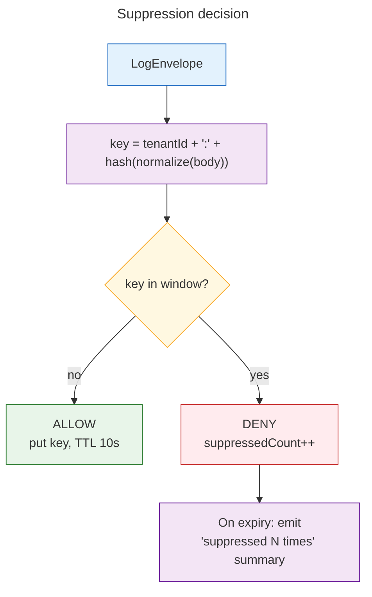
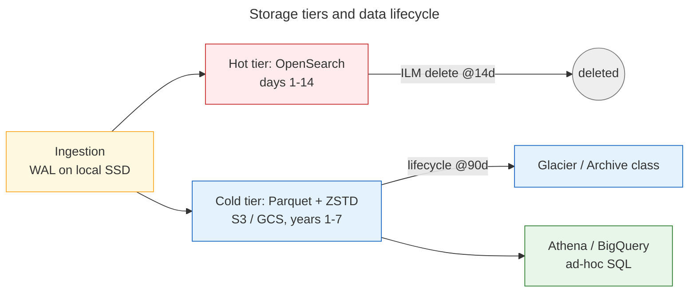
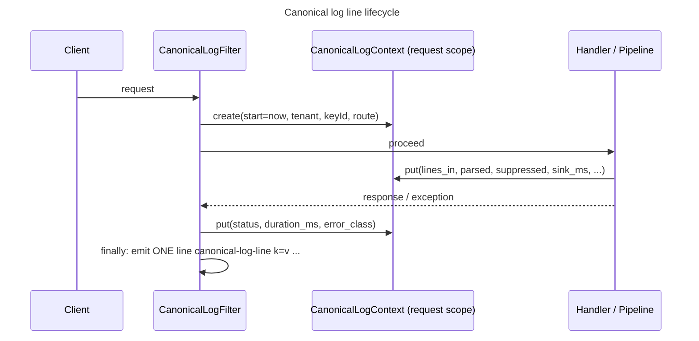

# Argus Scaling Design: High-Volume, Multi-Source Log Processing

> Status: **P0 implemented** (streaming file ingest, checkpoints, local sink; see [`P0_PLAN.md`](P0_PLAN.md)). **P1 implemented**: P1a (parser registry, format detection, `LogEnvelope`) and P1b (10s suppression API with local and Redis stores, streaming aggregation); see [`P1_PLAN.md`](P1_PLAN.md). P2–P5 are design only. Implementation follows the phased roadmap in §12.
> Inputs: [`PLAN.md`](../../PLAN.md) (target distributed architecture, functional requirements), [`SKILL.md`](../../SKILL.md) (format matrix, `LogEnvelope` pipeline), and the centralized-logging interview brief (10s suppression, multi-tenancy, search).

## Contents
1. [STAR framing](#1-star-framing-how-we-decide-before-we-build)
2. [Workload and capacity maths](#2-workload-and-capacity-maths)
3. [Component decomposition](#3-component-decomposition-ports-and-adapters)
4. [Backpressure](#4-backpressure)
5. [Offsets, checkpoints and prefills](#5-offsets-checkpoints-and-prefills)
6. [10-second suppression window](#6-10-second-suppression-window)
7. [Multi-tenancy and search](#7-multi-tenancy-and-search)
8. [Storage tiers](#8-storage-tiers)
9. [Live tail](#9-live-tail)
10. [Canonical log lines](#10-canonical-log-lines-stripe)
11. [Architecture Decision Records](#11-architecture-decision-records)
12. [SLOs and phased roadmap](#12-slos-acceptance-criteria-and-phased-roadmap)

---

## 1. STAR framing: how we decide before we build

Every significant decision is analysed with **STAR** before any code is written. It is the same structure used for the ADRs in §11.

| Step | Question it answers | What it must contain |
|---|---|---|
| **S — Situation** | Where are we today, and what hurts? | Facts verified against the code, plus measured or estimated limits. No opinions. |
| **T — Task** | What must be true when we're done? | Workload numbers, hard constraints (RAM, disk, cost) and SLOs. These become acceptance criteria. |
| **A — Action** | What are the options, and which do we pick? | At least 2 options, a trade-off matrix (correctness, latency, memory, ops cost, reversibility) and the choice with its reason. Prefer reversible choices. |
| **R — Result** | How do we know it worked? | Measurable results checked against the Task: a benchmark, load test, chaos test, or cost estimate. |

### Situation: Argus today
| Area | Current behaviour | Consequence at 10GB/day |
|---|---|---|
| Reading | `LogService.readLines` calls `Files.readAllLines` after a 50MB size guard | A 10GB file can't be read at all, and even 50MB becomes ~250MB+ of heap as objects |
| Parsing | `LogService.parseLineSafely` hardcodes access-log parsing; `parser/*` classes are not wired in | Duplicate logic; adding a format means editing the service (violates OCP) |
| Parser contract | `LogParser.parseLine(line, pattern)` is stubbed in most parsers (`JsonLogParser` returns `null`) | Violates ISP; callers can't rely on the method |
| Aggregation | `Aggregator.compute(List<LogRecord>)` | Needs every record in memory; can't stream |
| Ingestion | Synchronous Spring MVC, file path in the request | No streams, no batches, no remote sources |
| Durability | Results are returned in the HTTP response only | No persistence, offsets, or replay |
| Caching | Redis configured (`spring.cache.type=redis`) but no `@EnableCaching` / `@Cacheable` | Redis is effectively unused |
| Tenancy | None | No isolation of quota, search or storage |

### Task
Process **10GB/day** from Coralogix / ELK / files / streams on **one node with 4GB RAM and 100GB SSD**:
- in **≤500MB segments** streamed as **≤10,000-line micro-batches**;
- persist parsed output to **S3, GCS, or a Kubernetes PVC**;
- support suppression, multi-tenant search, and live tail;
- leave a clean path to the distributed target in `PLAN.md`.

---

## 2. Workload and capacity maths

Assumptions: 10GiB/day, ~300 bytes per line on average, a 10x peak-to-average burst factor. Re-measure line size against real data before sizing production.

| Quantity | Value | Derivation |
|---|---|---|
| Average ingest | **≈121 KiB/s** | 10 × 1024³ / 86,400 |
| Peak ingest | **≈1.2 MiB/s** | 10x burst |
| Lines per day | **≈36M** | 10GiB / 300B |
| Average / peak lines per second | **≈415 / ≈4,150** | 36M / 86,400, then ×10 |
| Lines per 500MB segment | ≈1.75M | streamed, never held in memory |
| 10k-line micro-batch | ≈3MB raw, ≈10–15MB on-heap | String + record object overhead ≈3–5x |
| In-flight batches (8) | ≈120MB heap | bounded queues, §4 |

**Conclusion:** at ~4k lines/s, the throughput is well within one JVM's limits *when streamed*. The real constraints are **memory discipline** and **disk capacity**, not CPU.

### Memory budget (4GB container)
| Consumer | Budget |
|---|---|
| JVM heap (`-XX:MaxRAMPercentage=60`) | ≈2.4GB: batches, dedup cache, tail buffers, parser state |
| Direct / off-heap (Netty, Parquet, ZSTD, multipart upload buffers) | ≈512MB (`-XX:MaxDirectMemorySize=512m`) |
| Metaspace, thread stacks, code cache | ≈300MB |
| OS page cache (sequential file reads, WAL) | the rest, ≈800MB |

### Disk budget (100GB SSD)
14 days of raw logs is **140GB, more than the 100GB disk**, so the hot search tier can't live on this disk. OpenSearch runs on its own cluster or volume (§8). The local SSD is a working area only:

| Use | Cap | Notes |
|---|---|---|
| Spool / WAL | 30GB (≈3 days of backlog) | Absorbs sink outages; high watermark 80% → pause pull sources and return 429 on push sources |
| Parquet staging | ≤2GB | Rolled files waiting to upload |
| Checkpoints | <100MB | One small file per source |
| Headroom | rest | Logs, heap dumps, OS |

Eviction: a segment in the WAL is deleted only after **every** sink it routes to has acknowledged it, oldest first, once usage passes the low watermark (60%).

### Cold storage growth
7 years × 10GiB/day ≈ **25TiB raw**. Parquet + ZSTD on log data typically compresses 8–12x, giving **≈2–3TiB** in object storage. A lifecycle rule moves objects to Glacier Instant/Flexible Retrieval or GCS Archive after 90 days.

---

## 3. Component decomposition (ports and adapters)

This is a modular monolith. Each stage is an **interface (port)** with pluggable **adapters**, extending the Strategy pattern Argus already uses for parsers and aggregators. Stages are connected by **bounded queues**, so the same boundaries can later become Kafka topics without rewriting the stages.

```mermaid
---
title: Argus Target Pipeline (modular monolith)
---
flowchart LR
    subgraph Sources
        S1[FileSource]:::src
        S2[DirectoryTailSource]:::src
        S3[HttpIngestSource]:::src
        S4[KafkaSource]:::src
        S5[ES / Coralogix Export]:::src
    end
    Sources --> F[RecordFramer<br/>lines, multiline, gzip/zstd]:::stage
    F --> P[ParserRegistry<br/>FormatDetector]:::stage
    P --> N[Normalize to LogEnvelope]:::stage
    N --> M[PII Mask]:::stage
    M --> D[Dedup / Suppress 10s]:::stage
    D --> E[Enrich K8s, trace]:::stage
    E --> R{Router}:::stage
    R --> W[(Local WAL)]:::store
    W --> K1[OpenSearchSink<br/>hot 1-14d]:::sink
    W --> K2[ParquetArchiveWriter<br/>S3 / GCS / PVC]:::sink
    D --> T[Live Tail fan-out]:::tail
    K1 & K2 -. ack .-> C[(CheckpointStore)]:::store
    C -. resume offset .-> Sources

    classDef src fill:#e3f2fd,stroke:#1565c0
    classDef stage fill:#f3e5f5,stroke:#6a1b9a
    classDef sink fill:#e8f5e9,stroke:#2e7d32
    classDef store fill:#fff8e1,stroke:#f9a825
    classDef tail fill:#fce4ec,stroke:#ad1457
```



### Package map (target)
| Package | Port | Adapters |
|---|---|---|
| `dev.dinesh.argus.source` | `LogSource` → emits `LogBatch(records, SourceOffset start, end)` | `FileSource` (chunked, resumes by byte offset), `DirectoryTailSource` (follows rotation using inode + offset), `HttpIngestSource` (NDJSON / gzip batch POST), `KafkaSource`, `ElasticsearchExportSource` (PIT + `search_after`), `CoralogixExportSource` |
| `dev.dinesh.argus.framing` | `RecordFramer` | `NewlineFramer`, `MultilineFramer` (stack traces by continuation regex), `JsonArrayFramer`; decompression decorators for gzip / zstd |
| `dev.dinesh.argus.parser` | `LogParser` (minus the `pattern` overload), `ParserRegistry`, `FormatDetector` | `JsonLogParser`, `KeyValueLogParser`, `ServerAccessLogParser`, `PatternLogParser` (configured regex), `LogbackPatternParser` (per SKILL.md) |
| `dev.dinesh.argus.model` | `LogEnvelope` | Fields: `eventId`, `tenantId`, `service.name`, `timestamp`, `observedTimestamp`, `severity`, `body`, `trace_id`, `span_id`, `attributes`, `source` + `offset`. Names follow OpenTelemetry log semantic conventions |
| `dev.dinesh.argus.pipeline` | `PipelineStage` (`LogEnvelope → Optional<LogEnvelope>`) | `Normalizer`, `PiiMasker` (cards, JWTs, passwords → keyed hash), `Suppressor` (§6), `K8sEnricher` |
| `dev.dinesh.argus.sink` | `LogSink` → `SegmentWriter` (`write(batch)`, `commit(endOffset)`, `abort()`; synchronous in P0, async acks with P2's multi-sink router) | `LocalVolumeSink` (PVC), `S3Sink` (multipart), `GcsSink` (resumable), `OpenSearchSink` (`_bulk`), `ParquetArchiveWriter` |
| `dev.dinesh.argus.checkpoint` | `CheckpointStore` | `FileCheckpointStore` (write tmp + `fsync` + atomic rename), later `KafkaCommittedOffsets` |
| `dev.dinesh.argus.tail` | `TailHub` | SSE broadcaster with per-connection ring buffers (§9) |
| `dev.dinesh.argus.tenant` | `TenantResolver`, `QuotaService` | API key / JWT resolver, Redis token bucket |
| `dev.dinesh.argus.aggregate` | `StreamingAggregator<S, T>` (`accept`, `merge`, `result`) | Existing aggregators ported to incremental form, so aggregation needs no `List` |

### Reuse of existing code
- `LogParser.canParse()` becomes the probe used by `FormatDetector`, which samples the first N lines of a source.
- `JsonLogParser`, `KeyValueLogParser` and `ServerAccessLogParser` are the first `ParserRegistry` entries. `LogService.parseLineSafely` is deleted in favour of the registry.
- `FilterSpec.toPredicate()` is reused unchanged for live-tail and search filters.
- The size guard in `LogService.readLines` is replaced by `FileSource` chunking; the limit becomes a per-segment cap.
- The `spring-boot-starter-data-redis` dependency already in the pom backs distributed dedup and quotas.

### Sink object layout
```
<bucket-or-pvc-root>/tenant=<tenantId>/dt=YYYY-MM-DD/hour=HH/source=<sourceId>/gen=<generation>/<startOffset>-<endOffset>.parquet
```
- Names come from **offsets**, so a retry overwrites the same object rather than creating a duplicate (idempotent).
- `dt`/`hour` come from the segment's **first record**, not the ingest date, so a segment replayed on a later day still lands on the same path.
- Each source gets its own `source=<id>/` folder: source ids may contain `-`, so a flat `<sourceId>-<start>-*` name pattern could match another source's files.
- `gen=` increments when the path holds a different file (rotation, truncation): offsets restart at 0, and without it the new file's first segment would replace the old file's.
- Hive-style partitions (`tenant=`, `dt=`, `hour=`) let Athena and BigQuery skip whole folders when a query filters on them.
- Roll a file at **128–256MB or 5 minutes**, whichever comes first, to avoid both tiny files and long latency.

---

## 4. Backpressure

**Rule:** when a downstream stage is slow, the slowdown must propagate back to the source **without unbounded buffering and without OOM**.

| Source type | Mechanism |
|---|---|
| Pull (file, tail, Kafka, ES export) | Stop reading when the first queue is full. Kafka: `consumer.pause(partitions)` / `resume`. Files: the reader thread blocks on `queue.put`. |
| Push (HTTP ingest) | Above the high watermark, return **429 Too Many Requests** with `Retry-After`. Agents (Fluent Bit, Vector) buffer locally and retry with backoff. Never accept data that can't be buffered durably. |

Each queue between stages is **bounded**, and each has a declared overflow policy:

| Boundary | Capacity | Overflow policy |
|---|---|---|
| Source → framer | 2 batches | block (pull) / 429 (push) |
| Parser → pipeline | 4 batches | block |
| Pipeline → WAL | 8 batches | block; the WAL absorbs sink stalls |
| WAL → sinks | disk-bounded (30GB) | high watermark pauses sources |
| Unparseable records | bounded DLQ file | write to the DLQ, count them, never block |
| Live tail | per-connection ring | drop oldest (§9), never block |

Sink failures are wrapped in Resilience4j retry (exponential backoff with jitter) and a circuit breaker. While the circuit is open, data accumulates in the WAL, up to its watermark.

Implementation choice (Reactor vs. bounded queues vs. virtual threads): see ADR-1.

---

## 5. Offsets, checkpoints and prefills

### Offsets per source
| Source | `SourceOffset` |
|---|---|
| File / tail | `path`, `inode` (detects rotation), SHA-256 of the first 1KB (detects `copytruncate`), `generation`, `byteOffset` |
| Kafka | `topic`, `partition`, `offset` |
| Elasticsearch export | PIT id + `search_after` sort values |
| Coralogix export | query window `[from, to)` + page cursor |
| HTTP ingest | client `batchId` + `seq` (used for idempotency on retry) |

**Delivery semantics: at-least-once with idempotent sinks**, which in practice gives effectively-once.
1. Batch `[start, end)` is processed and appended to the WAL.
2. Every routed sink acknowledges the batch.
3. Only then is the checkpoint advanced to `end`, written with tmp-file + `fsync` + atomic rename.
4. After a crash, processing resumes from the last checkpoint. Replayed records carry the same `eventId = hash(tenantId, sourceId, offset)`, so sinks overwrite rather than duplicate them: OpenSearch by `_id`, object stores by offset-derived names.

### Prefills
| Kind | What it does | Design |
|---|---|---|
| **Backfill / replay** | Re-process history: a past offset, a time range, or a bulk ELK / Coralogix export | Runs as a separate **replay lane** with its own bounded queues and a lower-priority quota (e.g. ≤30% of worker threads), so live ingest is never starved. Writes are idempotent because of `eventId`. Suppression is **bypassed** for replay, since it is a live-traffic concern. |
| **Warm-up** | Correct behaviour right after a restart | The dedup window is rebuilt by replaying the last 10s of the WAL. The live-tail ring is pre-filled from the WAL tail. For a re-index, build the new OpenSearch index behind an alias and swap the alias only once it has caught up. |
| **Read-ahead / prefetch** | Keep the parser busy | One chunk of prefetch per source, using async I/O for compressed or remote sources. It counts against the same queue capacity, so read-ahead can never exceed the memory budget. |

---

## 6. 10-second suppression window

**Requirement:** print a message only if an identical message hasn't been printed in the last 10 seconds, with an immediate allow/deny response, per tenant.



| Concern | Decision |
|---|---|
| **Key** | `tenantId + hash(normalized body)`. Normalization trims whitespace and casing. An optional, configurable **template fingerprint** also replaces numbers, UUIDs and hex ids with placeholders, so `user 42 failed` and `user 43 failed` count as the same message. It's off by default because the brief says "identical". |
| **Hash** | 64-bit xxHash / Murmur3. Collisions are acceptable: the worst case is one wrongly suppressed line. |
| **Single node** | Caffeine cache, `expireAfterWrite(10s)`, `maximumSize` bounded (e.g. 1M keys ≈ 100MB). Decisions take microseconds. |
| **Multi-instance** | Preferred: **partition by key**. Kafka key = suppression key, so each key has exactly one owning instance and a purely local cache stays correct. Fallback: Redis `SET key 1 NX PX 10000`, which is atomic. `OK` = allow, `nil` = deny. |
| **Clock** | Use **ingest (observed) time** for the window, so clients with skewed clocks can't bypass or extend it. Event time is used only for search and ordering. |
| **Ordering / regions** | Suppression is per region (AP). Accept rare duplicates across regions rather than paying for synchronous cross-region coordination. |
| **Hot keys** | One message repeated 100k/s hits only the local cache. With Redis, put a local "denied until T" negative cache in front, so a hot key costs one Redis call per window per instance. Per-tenant token buckets cap blast radius. |
| **Observability** | Count suppressed copies per key. On expiry, emit one summary line, `"<msg>" suppressed N times in 10s`, so no signal is silently lost. |
| **Failure mode** | If Redis is down, **fail open** (allow, and log in Argus's canonical line). Duplicates are better than lost logs. |

---

## 7. Multi-tenancy and search

| Concern | Design |
|---|---|
| Identity | `TenantResolver` derives `tenantId` from the API key or JWT claim at the edge. The client body can never set or override it. |
| Quotas | Per tenant: ingest rate (Redis token bucket), max tail connections, storage retention class. Exceeding the ingest quota returns 429 to that tenant only. |
| Hot-tier isolation | Large tenants: **index per tenant** (`logs-<tenant>-YYYY.MM.DD`). Small tenants: a shared index with `routing=tenantId` and filtered aliases, to avoid shard explosion (ADR-4). |
| Cold-tier isolation | Per-tenant prefix `tenant=<id>/`, IAM policies scoped by prefix, optional per-tenant KMS key. |
| Cache/key isolation | Every cache key, Redis key and object prefix starts with `tenantId`. |
| Search API | `GET /api/v2/search?tenant&from&to&service&severity&q=`. Queries for ≤14 days go to OpenSearch. Older ranges go to Athena / BigQuery over Parquet (asynchronous: returns a query id, then results are polled). The time range is required and bounded, to prevent unbounded scans. |

---

## 8. Storage tiers



### Ingestion phase
- The local WAL is the durable buffer.
- A router dual-writes batches to the hot sink and the archive writer.
- Each sink acknowledges independently, and the checkpoint advances only when both have acknowledged.
- When Kafka is introduced (PLAN.md §1.4), it replaces the WAL as the buffer and each tier becomes an independent consumer group.

### Hot tier (days 1–14): OpenSearch / Elasticsearch
- **Purpose:** operational monitoring, alerts, live debugging.
- **Lifecycle:**
  - daily rollover via ILM/ISM;
  - delete at 14 days (the cold tier holds the long-term copy).
- **Mappings** (where the disk saving actually comes from):
  - `severity`, `service.name`, `status`, `tenantId` as `keyword`. `doc_values` is already on by default for aggregations, and `keyword` fields **already have norms disabled**, so the brief's `norms: false` advice matters for `text` fields, not status strings.
  - `body` / `message` as `text` with `"norms": false` (no relevance-length scoring is needed for logs) and `index_options: "freqs"` if phrase queries aren't required.
  - Disable `doc_values` on high-cardinality fields that are never aggregated (e.g. `trace_id` is `keyword` with `doc_values: false`, searched but never aggregated).
  - `index.codec: best_compression` (DEFLATE/ZSTD, depending on the engine version).
  - `dynamic: strict` or a bounded `dynamic_templates` setting, to prevent mapping explosion from arbitrary attributes.
- The brief's "up to 35% saving" is a **target to measure** with a representative sample (index the same day with and without the mapping, then compare `_cat/indices` store size), not an assumption.

### Cold tier (years 1–7): S3 / GCS
- **Purpose:** compliance, security audit, historical analysis.
- **Format:** Apache Parquet, ZSTD-compressed, row groups of ~128MB, partitioned `tenant/dt/hour`, schema from `LogEnvelope` (attributes as a `map<string,string>` column).
- **Writer:** `ParquetArchiveWriter` buffers a row group in direct memory (counted in the 512MB off-heap budget), spills to Parquet staging on the SSD, and uploads with multipart (S3) or resumable (GCS) uploads.
- **Query:** Glue Data Catalog + Athena, or BigQuery external / BigLake tables. Partition projection avoids crawling. No re-indexing into the hot tier.
- **Compliance:** S3 Object Lock / GCS Bucket Lock (WORM) when regulations require it, and a lifecycle rule to the archive class after 90 days.
- **PVC option:** in Kubernetes without object storage, `LocalVolumeSink` writes the same layout to a PersistentVolume. Use a `ReadWriteMany` storage class if more than one pod writes, or one PVC per StatefulSet replica.

---

## 9. Live tail

**Goal:** near-real-time view of recent logs for a tenant and filter, **without ever slowing ingestion**.

| Concern | Design |
|---|---|
| Tap point | **After suppression** (users see what would be "printed"), before sinks. A per-tenant in-memory ring buffer (e.g. last 10k lines). Distributed version: a Redis Stream / Kafka topic per tenant partition. |
| Protocol | **SSE**: `GET /api/v2/tail?tenant=&level=&q=`. It's one-way, works over plain HTTP/1.1 and proxies, and reconnects automatically. WebSocket only if bidirectional control is needed later. |
| Filtering | On the server, using `FilterSpec.toPredicate()`, so filtered-out lines never use network bandwidth. |
| Slow consumers | Each connection gets a bounded queue (e.g. 1,000 lines). When it's full, **drop the oldest** lines and send a `{"dropped": N}` marker. The ingest pipeline never waits on a tail client. |
| Rate | If the matching rate exceeds a per-connection cap (e.g. 200 lines/s), sample and mark the stream as `sampled`. |
| Resume | Every event has an `id` (monotonic sequence). The browser's `Last-Event-ID` replays from the ring buffer if the line is still there; otherwise the stream starts fresh with a gap marker. |
| Limits | Per-tenant max concurrent tail connections (quota); idle timeout; heartbeat comment every 15s to keep proxies from closing the connection. |
| Restart | The ring is pre-filled from the WAL tail (warm-up, §5). |

---

## 10. Canonical log lines (Stripe)

Reference: <https://stripe.com/blog/canonical-log-lines>

**Idea:** in addition to ordinary log lines, emit **one wide, structured line per request (or unit of work)** at the very end. It collects every important fact in one place: status, duration, user/key, rate-limit state, database time, and so on. Queries then become simple filters and group-bys over one line type, instead of joins across scattered lines.

### How the computation works


1. A servlet `Filter` (or `HandlerInterceptor`) creates a request-scoped `CanonicalLogContext` and records the start time and identity.
2. Code along the request path **adds** fields: the parser count, suppressed count, sink latency, rate-limit remaining, and so on. These are plain map puts, with no I/O.
3. In the filter's `finally` block (so it also runs on errors), it computes `duration_ms` and the final `status`, then emits **exactly one** structured line (logfmt or JSON).
4. Because the line is emitted last, it can't be lost to an early return, and it always has the final status.

### Argus's own canonical line (per ingest batch or request)
```
canonical-log-line batch_id=7f3a tenant=acme source=file:/var/log/app.log offset_start=104857600 offset_end=107954211
lines_in=10000 parsed=9987 parse_errors=13 suppressed=412 bytes=3096611 parse_ms=41 sink_ms=118
sinks=opensearch,s3 wal_used_pct=12 status=ok duration_ms=171
```

### Consuming producers' canonical lines
When the applications Argus ingests emit canonical lines, `ParserRegistry` detects them, for example by the `canonical-log-line` prefix or a JSON `type` field. They're stored as **wide rows**, which is exactly what columnar Parquet is good at. In Athena, a question like "p99 latency by endpoint for tenant X last quarter" becomes a single `GROUP BY` over a few columns, without reading the others.

---

## 11. Architecture Decision Records

Each ADR follows the STAR template from §1. They're short on purpose: the reasoning is the record.

### ADR-1: Stage concurrency model
- **S:** Synchronous MVC with no stage boundaries; Java 17.
- **T:** Bounded memory, backpressure to sources, ~4k lines/s, simple to debug.
- **A:**

  | Option | Backpressure | Complexity | Notes |
  |---|---|---|---|
  | Reactor `Flux` + `limitRate` / `onBackpressureBuffer(bounded)` | built in, demand-driven | high (operators, debugging, blocking-call pitfalls) | Fits WebFlux ingest later |
  | **Bounded `BlockingQueue` + fixed worker pools** | blocking `put` / `offer` with timeout | low | Easy to reason about and test |
  | Virtual threads + bounded queues | same as above | low | Needs Java 21 (ADR-6) |

  **Choice:** bounded queues + worker pools now. Stage interfaces stay synchronous (`LogEnvelope → Optional<LogEnvelope>`), so they can later be run inside Reactor or virtual threads unchanged.
- **R:** A 10GB file with a stalled sink keeps heap ≤2.4GB and the source pauses (§12 test T3).

### ADR-2: Suppression state store
- **S:** Redis is available but unused.
- **T:** <1ms decisions, correct per tenant, survives an instance restart via warm-up.
- **A:** Local Caffeine (fastest, single owner required) vs. Redis `SET NX PX` (shared, ~0.3–1ms network round trip, a single point of failure) vs. partition-by-key + local cache (fast and correct, but needs keyed routing).
  **Choice:** Caffeine on a single node now. Partition-by-key once Kafka arrives. Redis `SET NX PX` as a fallback when routing by key isn't possible. Fail open.
- **R:** In a unit test, the same key twice within 10s → second is DENY; at 10.001s → ALLOW. Load test: 50k decisions/s with p99 <1ms locally.

### ADR-3: Cold archive format
- **S:** No archive.
- **T:** 7-year retention, ad-hoc SQL, minimal cost.
- **A:** Parquet (broadest engine support: Athena, BigQuery, Spark, DuckDB) vs. ORC (good compression, weaker BigQuery and tooling support) vs. compressed NDJSON (simple, but no column pruning).
  **Choice:** Parquet + ZSTD.
- **R:** Compression ratio ≥8x on a sample day; an Athena query over one column scans ≤15% of the bytes of the equivalent NDJSON.

### ADR-4: Hot-tier tenancy layout
- **S:** No tenancy.
- **T:** Isolation without shard explosion.
- **A:** Index per tenant (strong isolation, many shards) vs. shared index + routing + filtered aliases (efficient, weaker isolation) vs. a hybrid.
  **Choice:** Hybrid. Tenants above a size threshold (e.g. >1GB/day) get dedicated indices; all others share one index with routing.
- **R:** Shard count stays below the cluster's per-node guidance; a cross-tenant query returns 0 rows in tests.

### ADR-5: Checkpoint store
- **S:** No offsets.
- **T:** Crash-safe, simple, works on a PVC.
- **A:** Atomic-rename file per source (trivial, enough for one writer) vs. RocksDB (fast at scale, but a native dependency) vs. Kafka committed offsets (only for Kafka sources).
  **Choice:** File-based now; Kafka-native offsets for `KafkaSource`.
- **R:** Kill -9 during processing → restart resumes at the last acknowledged offset, with no gaps and only idempotent duplicates.

### ADR-6: Java version
- **S:** Java 17 (pom).
- **T:** Throughput and simplicity for I/O-heavy stages.
- **A:** Stay on 17 (no change) vs. move to 21 LTS (virtual threads, generational ZGC, Spring Boot 3.2+ support).
  **Choice:** Recommend 21 before P3 (HTTP ingest + many concurrent tail connections). Not required for P0–P2.
- **R:** A tail test with 1,000 concurrent SSE clients stays within the heap budget.

---

## 12. SLOs, acceptance criteria and phased roadmap

### SLOs / acceptance criteria
| # | Criterion | Target |
|---|---|---|
| T1 | Sustained throughput | ≥4,150 lines/s (peak) on 1 node, 4GB RAM |
| T2 | Memory | Heap ≤2.4GB, no OOM processing a single 10GB file |
| T3 | Backpressure | Sink stalled for 10 min → no OOM, sources paused or 429, WAL ≤ watermark, full recovery after the sink returns |
| T4 | Durability | Kill -9 at a random point → no lost records; duplicates only with the same `eventId` |
| T5 | Freshness | p99 ingest-to-searchable (hot tier) ≤30s |
| T6 | Suppression | Correct allow/deny at the 10s boundary; p99 decision <1ms (local) |
| T7 | Live tail | Visible ≤2s after ingest; a slow client can't affect ingest throughput |
| T8 | Replay | Replay any offset range without starving live ingest (live p99 latency degrades ≤20%) |
| T9 | Cost | Cold tier ≤3TiB at 7 years (8x+ compression) |

### Phased roadmap
| Phase | Scope | Maps to PLAN.md | Exit criteria |
|---|---|---|---|
| **P0** | `FileSource` (streamed chunks), `RecordFramer`, `CheckpointStore`, `LocalVolumeSink`, bounded queues | Phase 1 | T2, T4 on local disk |
| **P1** | `ParserRegistry` + `FormatDetector` (wire existing parsers, remove `parseLineSafely` duplication, drop `parseLine(line, pattern)` from the interface), `LogEnvelope`, `Suppressor`, `StreamingAggregator` | Phase 1 | T1, T6 |
| **P2** | `ParquetArchiveWriter`, `S3Sink`, `GcsSink`, WAL + watermarks, Resilience4j | Phase 1 / 3 | T3, T9 |
| **P3** | `HttpIngestSource` (429 backpressure), `TenantResolver`, `QuotaService`, ES / Coralogix export sources, replay lane | Phase 2 | T8, tenant isolation tests |
| **P4** | Live tail (SSE), canonical log lines (Argus's own + ingesting producers'), Micrometer metrics | Phase 3 | T7 |
| **P5** | `OpenSearchSink` hot tier with ILM and mappings; optional Kafka buffer + partition-by-key suppression; HPA on consumer lag | Phase 2 / 3, Deployment | T5 |

### Verification approach per phase
- **Unit:** each adapter against its port contract (shared contract test per port, so adapters are substitutable, per LSP).
- **Integration:** Testcontainers for MinIO (S3 API), fake-gcs-server, OpenSearch, Redis, Kafka.
- **Load:** generate 10GB with `DataSeeder` (extended to stream to disk), run with `-Xmx2400m` in a 4GB container, and record heap, GC pauses, lines/s and WAL usage.
- **Chaos:** kill -9 mid-batch, sink outage, disk at the high watermark, a slow tail client.
